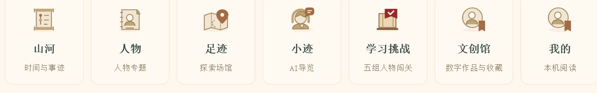

# v2.0 首页视觉修改汇总

更新日期：2026-10-20

基础版本：`xingrong111/cmit` 的 `v2.0` 分支，提交 `e5d8afa`。

本轮交付分支：`design/v2-home-polish-20261020`。

## 修改原则

保留仓库原有业务功能、数据与页面跳转。本轮调整字体、颜色、布局、装饰背景和指定说明文案。轮播、地图、人物档案、学习、文创、账户和阅读记录的业务逻辑不变。

以下为最终效果，已覆盖沟通过程中的中间方案。

## 1. 字体与阅读层级

- 网页文字统一采用宋体字体栈：`SimSun, STSong, serif`，保留专用图标字体。实际字体取决于访问设备已安装的字体。
- 首页顶部统计数字恢复原来的 `Georgia, serif` 数字样式；红色数字与绿色说明保持区分。
- 主标题、统计说明、三个探索入口采用厚重宋体，通过字重及轻微描边增强视觉分量。
- 辅助说明从原来的小字号提高到约 15—18px；重要操作和状态进一步加粗。
- 保留原有标准／大字号偏好设置及控制逻辑。

## 2. 地图与统计区域

- 顶部统计数字桌面端保持 40px，说明放大到 30px 并加粗；窄屏适当缩小和换行。
- “当前选中”角标内全部文字放大，省名加重，人数与省名分开呈现。
- 桌面地图 ＋、−、复位按钮扩大到 54×54px；缩放符号 32px，复位文字 20px。手机端使用 48×48px。
- 右侧标题删除英文 `SELECTED REGION`，保留“循迹一站”，桌面 28px，手机 25px，使用厚重宋体。
- “查看人物名单”“选择其他省份”等按钮文字增至桌面 22px、手机 20px。
- “读一位人物／学一段历史／循一处足迹”的绿色标题加大、加粗。
- 保留地图拖动、缩放、复位、省份选择、人数与人物名单跳转。

## 3. 首页三张轮播

- 使用本轮提供的山水总览、瞿秋白、窗边人物三幅参考画面作为装饰资源。
- 采用水墨山水、人物融合、暖白底色和朱红操作按钮的统一风格，取消原人物图的矩形底框效果。
- 原网页标题、说明和按钮继续由原组件渲染；参考画面通过 CSS 裁切及渐变与这些元素融合。
- 三张分别保留“走近人物”“阅读档案”“进入故事”原跳转。
- 保留标签、上一张／下一张、循环切换及触摸滑动逻辑。
- 最终宽度为内容区 100%，与上方三个入口卡片左右对齐。
- 按后续要求连续降低高度。最终桌面画面高度为 `clamp(370px, 27vw, 465px)`，1440px 视口约 389px，另加底部切换栏；手机画面高度 600px。
- 根据缩小后的画面同步调整标题、按钮、内边距和切换栏，保留说明文字可读性。

## 4. 长卷横幅

- 原纯色深绿横幅改为深绿山水、金色细节与浅色按钮的形式。
- 参考图中央山水用作背景；标题、山河长卷四个字框、说明与按钮仍为网页元素。
- “02／山河长卷”栏目标注放大加粗；标题与正文保持清晰对比。
- 保留整个横幅点击进入长卷，以及“展开长卷”按钮的原跳转。
- 手机端上下排列，保留全部文字与入口。

## 5. 人物照片与档案按钮

- “阅读档案”及现有学习按钮文字放大，原事件处理不变。
- 首页照片的来源按钮在支持鼠标悬停的设备上默认透明，悬停照片区域或键盘焦点进入该区域时显示。
- 触屏设备仍显示来源按钮，保留来源查看入口。
- 图片图注、原图预览、来源资料弹窗、复制来源及人物／IP切换逻辑不变。

## 6. 阅读概览与栏目标注

- 去掉首页底部“山河为卷，史料为据／已核片段持续整理·山水为艺术化装饰”这一行说明。
- 去掉概览右侧“本批资料范围／完整生平持续整理中”。仅隐藏这两处指定展示，不删除数据或入口。
- “循迹、见史”放大到桌面 34px、手机 29px，并加重；旁边说明放大加粗。
- 01／人物专题、03／史料片段的栏目标注提高到桌面 27px 并加重。
- 02／山河长卷标注提高到桌面 38px，并采用金色厚重宋体。

## 7. 史料片段卡片

- “政协会议相关记载”和两个“遇害记载”标题采用 30px、900 字重及轻微描边，手机端 27px。
- 姓名提高到桌面 24px、手机 22px，并加粗、加深颜色。
- 日期提高到桌面 22px、手机 20px，并加粗。
- 史料摘要、阅读入口放大后继续加深，保留标题与辅助文字的层级。
- 保留原文、日期、人物关系及“阅读片段”跳转。

## 8. 更多入口

- 七个原有入口：山河、人物、足迹、小迹、学习挑战、文创馆、我的，桌面全部排为一行。
- 使用七列布局，缩窄单卡宽度并放大文字：桌面标题 23px，说明 17px。
- 窄屏保持一排并允许横向浏览，全部入口保留。

## 修改位置与同步范围

- 主视觉样式：`v2/frontend/src/static/v2-视觉.css`。
- 文创模块字体：`v2/services/wenchuang/public/wenchuang.css`。
- 地图静态标题文案：`v2/frontend/src/components/山河地图.vue`，仅删除英文后缀。
- 新背景资源：`v2/frontend/src/static/首页轮播/`。
- 同步网页交付副本中的源码、页面静态资源、对应首页构建脚本的静态标题文字，以及文创模块样式。
- 本轮主要针对网页；未同步重建微信导入包，未作微信真机验收。

## 功能核对与验证边界

- 核对 1073 个原有脚本、页面模板和数据文件。
- 除指定“循迹一站”静态标题文字外，原有文件内容未因本轮样式修改而改变；对该文案差异规范化后，功能差异为 0。详见同目录《首页视觉功能核对.json》。
- 浏览器验证了轮播标签与前后切换、“走近人物”跳转、“展开长卷”跳转、七个入口同排、标题和按钮实际字号。
- 地图放大从 100% 到 135%，复位回到 100%，已实测。
- 查看了桌面与手机排版。来源按钮已核对桌面默认隐藏规则；未使用自动化鼠标悬停工具逐项测试所有照片。
- 业务逻辑未改，不等同于已对登录、评论、答题、文创领取和所有全景场景进行完整端到端回归。
- 未部署公网。推送 GitHub 不会自动更新原 Sites 线上站点。

## 在新下载的仓库中运行网页

需要 Node.js 24。仓库含网页交付文件，依赖和运行生成文件不上传。先在 `v2/services/reading` 安装依赖：

```powershell
npm.cmd ci --prefix v2/services/reading
```

将已同步的网页页面复制到本地服务默认静态目录，然后启动：

```powershell
New-Item -ItemType Directory -Path 'v2/frontend/dist/build' -Force
Copy-Item -LiteralPath 'v2/网页端/页面' -Destination 'v2/frontend/dist/build/h5' -Recurse
node v2/启动服务.mjs
```

复制步骤用于尚无 `h5` 目录的新下载项目；已有目录时应先按项目正常流程更新构建，避免产生嵌套目录。浏览器打开 `http://127.0.0.1:3210/`。本机模型和地图服务配置按原项目说明设置，不将密钥上传 GitHub。

## 最终预览截图

截图用于说明本轮页面效果；查看当前网页可获得最新显示。



